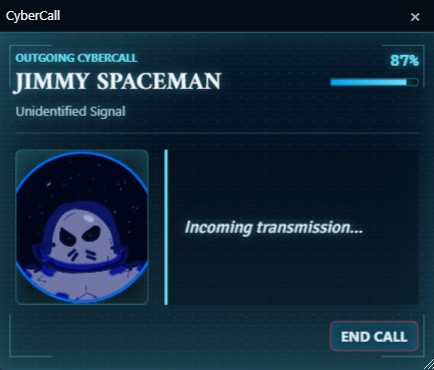

# CyberCall

Calls, messages, and NPC conversations on a sci-fi commlink for Foundry VTT. Requires **HoloSuite Core** and supports **Foundry 12–14**.

## What Does It Do?

- Send calls to selected players or broadcast to everyone, including fullscreen transmissions.
- Choose standard, emergency, or corrupted visuals. Lower signal strength adds portrait glitches.
- Keep personal and shared contacts, send private messages, and create group chats.
- Reply as an NPC, with separate conversations for each NPC and player.
- Choose ringtones and message sounds, including audio added by the GM.

## Tutorial: Using CyberCall as a DM

### Sending a Call

1. Enable **CyberCall** and **HoloSuite Core** in your world.
2. Open CyberCall from the HoloSuite launcher.
3. Choose an Actor or enter the caller's name, portrait, subtitle, and message.
4. Set the signal, visual style, recipients, and whether to use ringing or fullscreen mode.
5. Use **Preview Locally**, then **Broadcast to Players** when ready.

### During the Call

Click **Accept** to connect, or **Decline** to dismiss an incoming call. **End Call** closes the call for everyone involved.

### Handling Player Calls

Calls to NPC contacts arrive on the GM's screen. Accept the call to play out the conversation, then end it when finished.

## Tutorial: Using CyberCall as a Player

### Receiving Calls

Incoming calls appear on your screen. Click **Accept** to answer or **Decline** to dismiss them.

### Making Calls

Open CyberCall from the HoloSuite launcher. Add a contact to your personal list, or choose one from the shared **Group** list, then click **Call**. A GM must be connected to save changes to shared contacts.

### Choosing a Ringtone

Choose your ringtone and notification sound in CyberCall's **Settings**. The GM can add audio through **Additional Ringtones** and **Manage Notification Sounds** in Foundry's module settings. Call volume and message alerts can also be adjusted in settings.

### Sending Messages

Click **Message** beside a contact, or open **Messages → New**. Use **New Group** to start a group chat; offline players can join the conversation when they return.

GMs can select **Send As** to message as an NPC. Choosing an Actor links it immediately; existing conversations can also be linked by dragging an Actor or token onto them. Use **Share Portrait** to show the NPC's portrait to that player.

Player conversations are private from GMs unless **GM: View Player Conversations** is enabled. An eye indicator shows when this setting is on.

Messages persist between sessions. **Delete Thread** hides a thread only for you. Call history keeps the newest **100 call events per world** and removes older events when a GM is connected; text messages are kept.

## Commlink device shell

Contacts, messages, history, and calls share a resizable commlink interface. Portraits fit inside the display, and lower signal strength adds interference. Reduced-motion preferences turn off these animations.

## GM contact management and configuration

Use **Contacts → Player Lists** to view and edit a player's personal and assigned contacts. Older personal lists become available after that player connects once. Players can edit their own contacts; GM-assigned contacts are read-only for them.

The console's **Configuration** tab includes:

- **Phone number format:** `#` for a digit, `A` for a letter, or `*` for either. For example, `AAA-####` accepts `FED-0071`. Other characters are inserted as fixed text. Leave blank for unrestricted numbers.
- **Device emblem:** browse or upload a custom image. HoloSuite Branding takes priority when available; older Core versions use this image normally.
