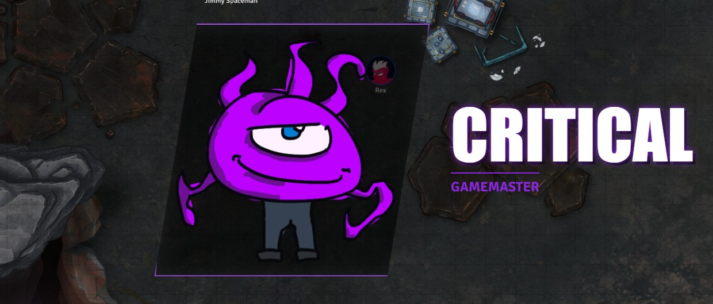

# HoloSuite Critical Cut-In

Show a character portrait, text, and sound when a roll hits your success or failure threshold. Works with Foundry V12–V14 and requires **HoloSuite Core**.

## Set up your rolls

1. Enable **HoloSuite Core** and **HoloSuite Critical Cut-In** in your world.
2. Go to **Configure Settings → Module Settings → HoloSuite Critical Cut-In** and open **Configure Player Cut-Ins**.
3. Under **Global Settings**, choose your **Check Die**, **Amount of Dice**, and whether high or low rolls are good. Set your success and failure thresholds, then save.

With **Check Die** set to d6 and **Amount of Dice** set to 2, the module checks the raw total of exactly two active d6s. With the amount set to 1, it checks each die separately. The check skips modifiers, discarded dice, rerolled dice, and rolls it identifies as damage. A percentile roll must use a d100 term to match the d100 setting.

A global threshold of 0 uses the best or worst possible result. Changing the die, amount, or roll direction asks you to confirm a threshold reset. You can edit the thresholds again before saving.

## Set up your characters

- Select a player and character. Set up **Critical Success** and **Critical Failure** separately. Each has its own **Enabled** switch, threshold, animation, duration, portrait, sound, text, and color.
- Leave the portrait blank to use the actor's portrait. Leave the threshold or duration blank to use the global setting.
- Drag characters into order, or focus a row and press **Alt + Up/Down**. The first character's portrait appears on the player's tab.
- Use the **GM** entry for GM cut-ins. Turn on **Use token portrait** to use the rolling token's artwork when available.
- Scroll the animation row to browse all 15 styles. Click **Test Cut-In** to see and hear the selected animation on your own screen.

**Default Success Audio** and **Default Failure Audio** are separate switches in **Global Settings**. Both start off. Custom audio takes priority over the default.

## Glory Roll

1. As the active GM, click **Glory Roll** next to the player tabs.
2. Pick who rolls and enter a Foundry formula such as `2d6 + 3`. Add stakes or a success target if you want.
3. Click **Show Arena to Table**. The chosen roller clicks **Roll & Reveal**.

The target follows your high or low roll setting. Success throws gold confetti, failure shows a red fade, and chat includes the subtotal for each dice term. If Dice So Nice is enabled, 3D dice roll inside the circle and get smaller as the pool grows. The GM can cancel before the roll.

## Player settings

Cut-ins play automatically. In **Module Settings**, each player can adjust motion, flash, shake, effect detail, and volume, or hide cut-ins on their client. Reduced and still motion turn off shake.

The GM can use **Animation Font** to choose AICON or Classic. The bundled AICON font by Eko Bimantara comes with its [original license](assets/fonts/AICON-LICENSE.txt).
